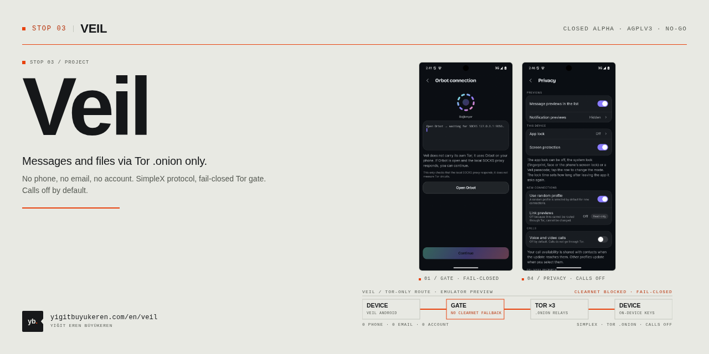
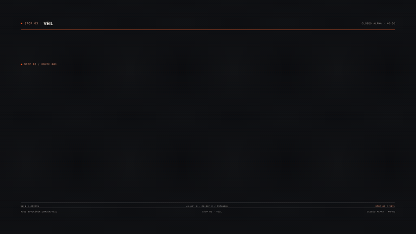
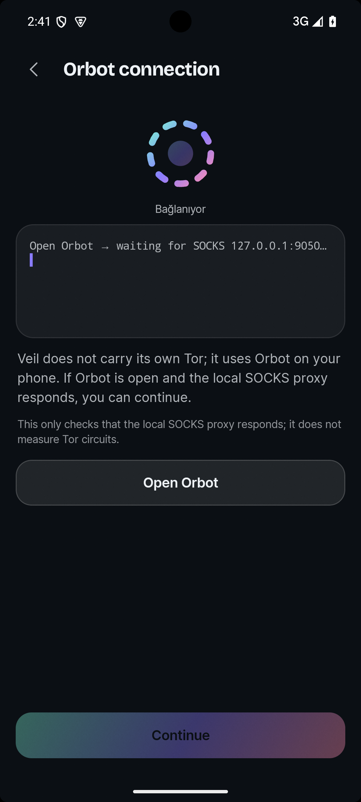
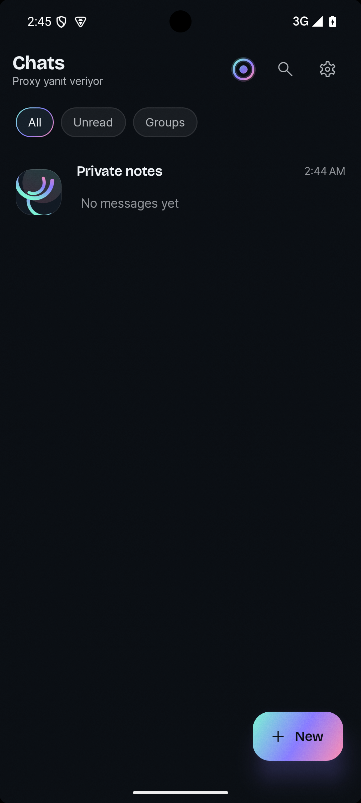
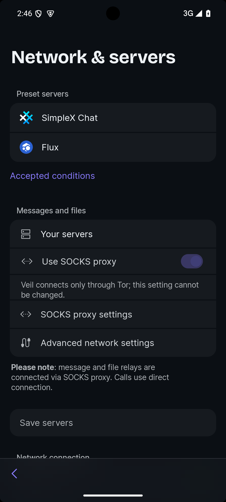
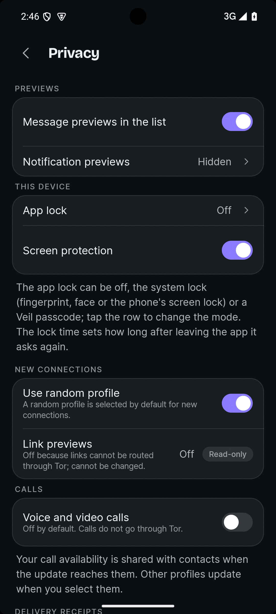

<a href="https://yigitbuyukeren.com/en/veil/">
  <picture>
    <source media="(prefers-color-scheme: dark)" srcset="docs/veil/banner-dark.png">
    
  </picture>
</a>

# Veil

**Privacy-first, accountless Android messaging — closed alpha in development.**

Messages and files via Tor `.onion` only · SimpleX protocol · Fail-closed gate · Calls off by default

**[🎬 Launch Video](#demo-video)** &nbsp;·&nbsp; **[🌐 Website](https://yigitbuyukeren.com/en/veil/)** &nbsp;·&nbsp; **[📋 Status Report](docs/veil/DEVELOPMENT_STATUS.md)** &nbsp;·&nbsp; **[🛡️ Security](SECURITY.md)**

🇬🇧 [English](#en) &nbsp;·&nbsp; 🇹🇷 [Türkçe](#tr) &nbsp;·&nbsp; [Demo Video](#demo-video) &nbsp;·&nbsp; [Screenshots](#screenshots) &nbsp;·&nbsp; [Security](#security) &nbsp;·&nbsp; [Status](#status) &nbsp;·&nbsp; [Docs](#docs)

> [!IMPORTANT]
> **Veil is an unaudited closed alpha. Do not rely on it where your safety depends on it.** The release decision is **NO-GO**: there is no real-device or Orbot evidence, most of the leak-test matrix is **NOT TESTED**, license gaps remain open, and no independent review exists. See [Development status](docs/veil/DEVELOPMENT_STATUS.md) and the [M1 release report](docs/veil/M1_RELEASE_REPORT.md).

**▶ [English launch film with audio (MP4, 2.2 MB)](docs/veil/media/veil-launch-16x9-en.mp4)** &nbsp;·&nbsp; **[Türkçe lansman filmi (MP4, 2.3 MB)](docs/veil/media/veil-launch-16x9-tr.mp4)**

15-second 1080p60 launch film combining motion graphics with live Android emulator debug-build UI previews of the Tül redesign (marked "Live UI / Emulator Preview" in the film). Emulator preview only — not real-device or Orbot field verification. Veil remains an unaudited closed alpha.

---

## 🇬🇧 English

### Overview

Veil is a privacy-first, accountless Android messaging client built on the SimpleX protocol. It ships the official prebuilt SimpleX core (verified by hash and signature) and changes only the app layer: the Tül redesign, a fail-closed Tor gate, locked network settings, privacy defaults and English/Turkish UI. The first target is a **closed Android alpha**, not a finished or audited product.

Veil is an independent derivative of the SimpleX Chat client. It is not affiliated with, endorsed by, or supported by SimpleX Chat Ltd; the SimpleX name is used only to describe the upstream code and the network it connects to.

Messages and files go only through Tor; calls (if enabled) are off by default and do not go through Tor. Tor does not protect against traffic correlation.

### Screenshots

  

<b>Orbot Gate</b> — fail-closed start screen; the check confirms that the local SOCKS proxy answers, not that Tor circuits exist.

| Tül Chat List | Locked Tor Network | Privacy Controls |
|:---:|:---:|:---:|
|  |  |  |

Live 1080×2400 captures from the Tül redesign running in an Android emulator debug build (arm64, Android 15). This is an emulator debug build, not real-device or Orbot field verification; the SOCKS gate checks only that the local proxy responds, not Tor circuits.

### What M1 aims to prove

These are M1 aims, not verified release claims. The verification matrix below records what is actually tested.

| M1 aim | Target |
|---|---|
| **No account** | No phone number or email needed; no central cross-chat user identifier. |
| **Encrypted messaging** | End-to-end encrypted one-to-one messaging through Tor `.onion` relay endpoints. |
| **Offline delivery** | Store-and-forward: the sender may disconnect after relay acceptance; the receiver retrieves later. |
| **Local history** | Persistent, locally encrypted chat history. |
| **Small groups** | Private small-group chats, invitations and basic membership controls. |
| **Fail-closed network** | No automatic clear-network fallback when Tor is unavailable. |

### Security Disclaimer & Limits

> [!WARNING]
> **Veil is an unaudited closed alpha. Do not rely on it where your safety depends on it.** Tor and end-to-end encryption are **not a guarantee of 100% anonymity**. Endpoint compromise, traffic correlation, malicious participants, device metadata and other risks remain. The Android implementation and the complete set of network egress paths require testing. No release should claim security guarantees without evidence.

- **Transport scope:** Messages and files go only through Tor; calls (if enabled) are off by default and do not go through Tor. When calls are enabled, relay-only ICE is forced, but call media still does not use Tor, and the call server sees the IP address and timing.
- **Correlation:** Tor does not protect against traffic correlation.
- **Fail-closed policy:** The start gate waits for a responding Tor SOCKS proxy and never falls back to a direct connection. The policy is enforced at a single choke point (`apiSetNetworkConfig`), and network settings are locked read-only. Code and unit tests exist; running-app and device behavior are **NOT TESTED**.
- **History:** Chat history is stored encrypted on the device, but it is not protected on an unlocked or compromised device, and key storage has not been audited.
- **In-app claims:** 25 `veil_` strings remain pending evidence. Distribution stays **NO-GO** until each is backed or softened, per the [privacy claims policy](docs/veil/PRIVACY_CLAIMS.md).
- **No audit:** There is no real-device verification and no independent security audit.

### Current State & Verification

Veil is an unaudited closed alpha in development. The Tor-only network policy is implemented in the app layer (fail-closed start gate, enforced at a single choke point, network settings locked). It has unit tests and earlier emulator runs; the latest changes are not verified on a device, there is no real-device verification and no independent security audit. The current release decision is NO-GO. For every status fact, docs/veil/DEVELOPMENT_STATUS.md is the single status source ([open the status document](docs/veil/DEVELOPMENT_STATUS.md)).

| Check | Recorded result (latest evidence 2026-11-10) |
|---|---|
| **Release decision** | **NO-GO** — no real-device or Orbot evidence, leak matrix mostly **NOT TESTED**, open license gaps, no independent review ([M1 release report](docs/veil/M1_RELEASE_REPORT.md)) |
| **Android build** | arm64-v8a FOSS debug build **PASS**; official prebuilt `libsimplex.so`/`libsupport.so` from SimpleX Chat v7.0.3 verified by SHA-256 and GPG in CI; not built from source by decision ([native core](docs/veil/NATIVE_CORE.md)) |
| **Unit tests** | **273** Veil Android common unit tests **PASS** (264 on the chat-bar commit); the full upstream common suite retains 5 environment-related failures in `ChatItemsMergerTest`, `ProviderForGalleryTest` and `ThemesTest` |
| **CI checks** | `docs-check.sh`, `strings-check.sh`, `policy-check.sh` and `egress-check.sh` **PASS**; CI green on `main` |
| **Tor-only enforcement** | Enforced at `ChatController.apiSetNetworkConfig`; network settings locked read-only; the status screen reads `VeilNetworkPolicy.isCompliant`. Code and unit tests only; running-app and device behavior **NOT TESTED** |
| **Emulator scenarios** | E2EE pairing (E1–E4), offline store-and-forward (E5–E6), encrypted history (E7–E8) and 2-member groups (E10–E11, E19) recorded on two emulators; E12 delivery-state semantics, wrong-contact and key-change warnings **NOT TESTED** |
| **Real device + Orbot** | **NOT TESTED** — required for M1 gates and in-app claim evidence; **NO-GO** for distribution |
| **Licensing** | `android-support` declares no license (distribution blocker); Haskell/native inventory is approximate; LGPL notice/replace duties (GMP, libiconv, trove4j) are not implemented ([upstream licenses](docs/veil/UPSTREAM_LICENSES.md)) |
| **In-app privacy claims** | **25** `veil_` strings remain pending evidence; distribution **NO-GO** until each is backed or softened ([privacy claims policy](docs/veil/PRIVACY_CLAIMS.md)) |
| **Tül redesign & M3 flows** | Implemented in code and unit-tested; device and Orbot flows **NOT TESTED**. The emulator captures above show rendering only and do not close any device gate |

### Contributing

Veil is open source and developed in public, but the project is evidence-gated: a change is not done because it compiles, and no behavior is called working without a recorded run. Read [docs/veil/CONTRIBUTING.md](docs/veil/CONTRIBUTING.md) before opening an issue or a pull request. Documentation, translation, emulator scenarios and leak-test scripts are useful now; pairing and real-device tests stay blocked until two Android phones and Orbot are available ([roadmap](docs/veil/ROADMAP.md)).

### Source & Licenses

- **Upstream:** [simplex-chat/simplex-chat](https://github.com/simplex-chat/simplex-chat)
- **Upstream Android build:** [apps/multiplatform README](https://github.com/simplex-chat/simplex-chat/blob/stable/apps/multiplatform/README.md)
- **Public server terms:** [simplex.chat/privacy](https://simplex.chat/privacy/)
- Upstream code is **AGPLv3**; licenses and copyright attribution of forked material must be preserved. The upstream brand/logos may be protected separately.
- Provenance of this repository (upstream release, commit and license): [NOTICE](NOTICE); full dependency inventory: [third-party notices](docs/THIRD_PARTY_NOTICES.md).

### Documentation

Veil's own documents are in [docs/veil/](docs/veil/); the rest of `docs/` is upstream's. docs/veil/DEVELOPMENT_STATUS.md is the single status source ([open the status document](docs/veil/DEVELOPMENT_STATUS.md)).

| Area | Documents |
|---|---|
| **Direction** | [Vision](docs/veil/VISION.md) · [Design](docs/veil/DESIGN.md) · [Roadmap](docs/veil/ROADMAP.md) |
| **Status & release** | [Development status](docs/veil/DEVELOPMENT_STATUS.md) · [M1 release report](docs/veil/M1_RELEASE_REPORT.md) · [Emulator tests](docs/veil/EMULATOR_TESTS.md) · [Backup tests](docs/veil/BACKUP_TESTS.md) |
| **Security** | [SECURITY.md](SECURITY.md) · [Threat model](docs/veil/THREAT_MODEL.md) · [Privacy claims policy](docs/veil/PRIVACY_CLAIMS.md) · [Tor-only transport](docs/veil/TOR_ONLY.md) · [Network egress](docs/veil/NETWORK_EGRESS.md) · [Privacy defaults](docs/veil/PRIVACY_DEFAULTS.md) |
| **Build & sources** | [Android build](docs/veil/ANDROID_BUILD.md) · [Native core decision](docs/veil/NATIVE_CORE.md) · [Upstream base](docs/veil/UPSTREAM.md) |
| **Licenses & relays** | [Upstream licenses](docs/veil/UPSTREAM_LICENSES.md) · [Third-party notices](docs/THIRD_PARTY_NOTICES.md) · [Relay usage](docs/veil/RELAY_USAGE.md) · [NOTICE](NOTICE) |
| **Contributing** | [Veil contributing guide](docs/veil/CONTRIBUTING.md) · [Upstream contributing guide](docs/CONTRIBUTING.md) |

---

## 🇹🇷 Türkçe

### Genel Bakış

Veil, SimpleX protokolü üzerine kurulu, gizlilik odaklı ve hesapsız bir Android mesajlaşma istemcisidir. Resmî önceden derlenmiş SimpleX çekirdeğini kullanır (hash ve imza ile doğrulanır) ve yalnızca uygulama katmanını değiştirir: Tül yeniden tasarımı, kapalı başlangıç Tor kapısı, kilitli ağ ayarları, gizlilik varsayılanları ve Türkçe/İngilizce arayüz. İlk hedef, bitmiş ya da denetlenmiş bir ürün değil, **kapalı bir Android alfa sürümüdür**.

Veil, SimpleX Chat istemcisinin bağımsız bir türevidir. SimpleX Chat Ltd ile bağlantılı, onun tarafından desteklenen veya onaylanan bir proje değildir; SimpleX adı yalnızca üst kaynak kodu ve bağlandığı ağı tanımlamak için kullanılır.

Mesajlar ve dosyalar yalnızca Tor üzerinden gider; aramalar (açılırsa) varsayılan olarak kapalıdır ve Tor üzerinden gitmez. Tor, trafik korelasyonuna karşı koruma sağlamaz.

> [!IMPORTANT]
> **Veil denetlenmemiş bir kapalı alfa sürümüdür. Güvenliğiniz buna bağlıysa kullanmayın.** Sürüm kararı **NO-GO**'dur: gerçek cihaz veya Orbot kanıtı yoktur, sızıntı test matrisinin büyük bölümü **NOT TESTED** durumundadır, lisans boşlukları açıktır ve bağımsız inceleme yoktur. Bkz. [Geliştirme durumu](docs/veil/DEVELOPMENT_STATUS.md) ve [M1 sürüm raporu](docs/veil/M1_RELEASE_REPORT.md).

### Lansman Videosu ve Ekran Görüntüleri

- **🎬 Lansman filmi:** [İngilizce film, sesli (MP4, 2.2 MB)](docs/veil/media/veil-launch-16x9-en.mp4) · [Türkçe film (MP4, 2.3 MB)](docs/veil/media/veil-launch-16x9-tr.mp4)
- **📸 Ekran görüntüleri:** [4 ekranlık canlı emülatör galerisi](#screenshots) — Orbot kapısı, Tül sohbet listesi, kilitli Tor ağı ve gizlilik kontrolleri.

15 saniyelik 1080p60 lansman filmi, hareketli grafikler ve Tül tasarımının canlı Android emülatör debug derlemesi arayüz önizlemeleriyle kurgulanmıştır (filmde "Live UI / Emulator Preview" olarak işaretlidir). Yalnızca emülatör önizlemesidir; gerçek cihaz veya Orbot saha doğrulaması değildir. Veil denetlenmemiş bir kapalı alfa sürümü olmaya devam eder.

### M1 Neyi Kanıtlamayı Amaçlıyor?

Bunlar M1 hedefleridir, doğrulanmış sürüm iddiaları değildir. Aşağıdaki doğrulama matrisi gerçekte test edilen durumu kaydeder.

| M1 hedefi | Amaç |
|---|---|
| **Hesap yok** | Telefon numarası veya e-posta gerekmez; sohbetler arası merkezî bir kullanıcı tanımlayıcısı yoktur. |
| **Şifreli mesajlaşma** | Tor `.onion` röle uç noktaları üzerinden uçtan uca şifreli bire bir mesajlaşma. |
| **Çevrimdışı teslimat** | Sakla-ve-ilet: gönderen röle kabulünden sonra bağlantıyı kesebilir; alıcı daha sonra alır. |
| **Yerel geçmiş** | Cihazda kalıcı ve şifreli sohbet geçmişi. |
| **Küçük gruplar** | Özel küçük grup sohbetleri, davetler ve temel üyelik kontrolleri. |
| **Kapalı ağ politikası** | Tor kullanılamadığında otomatik açık ağ yedeği yoktur. |

### Güvenlik Uyarısı ve Sınırlar

> [!WARNING]
> **Veil denetlenmemiş bir kapalı alfa sürümüdür. Güvenliğiniz buna bağlıysa kullanmayın.** Tor ve uçtan uca şifreleme tek başına anonimlik sağlamaz. Uç nokta ele geçirilmesi, trafik korelasyonu, kötü niyetli katılımcılar, cihaz üst verisi ve diğer riskler sürer. Android uygulaması ve tüm ağ çıkış yollarının test edilmesi gerekir. Hiçbir sürüm kanıt olmadan güvenlik iddiası yayımlamamalıdır.

- **Taşıma kapsamı:** Mesajlar ve dosyalar yalnızca Tor üzerinden gider; aramalar (açılırsa) varsayılan olarak kapalıdır ve Tor üzerinden gitmez. Aramalar açıldığında relay-only ICE zorlanır; ancak çağrı medyası yine Tor kullanmaz ve çağrı sunucusu IP adresini ve zamanlamayı görür.
- **Korelasyon:** Tor, trafik korelasyonuna karşı koruma sağlamaz.
- **Kapalı politika:** Başlangıç kapısı yanıt veren bir Tor SOCKS proxy'si bekler ve doğrudan bağlantıya asla düşmez. Politika tek darboğazda (`apiSetNetworkConfig`) zorlanır ve ağ ayarları salt okunur. Kod ve birim testleri vardır; çalışan uygulama ve cihaz davranışı **NOT TESTED**.
- **Geçmiş:** Sohbet geçmişi cihazda şifreli saklanır; ancak açık veya ele geçirilmiş bir cihazda korunmaz ve anahtar saklama denetlenmemiştir.
- **Uygulama içi iddialar:** 25 `veil_` dizesi kanıt bekliyor. Dağıtım, [gizlilik iddiaları politikasına](docs/veil/PRIVACY_CLAIMS.md) göre her biri desteklenene veya yumuşatılana kadar **NO-GO** olarak kalır.
- **Denetim yok:** Gerçek cihaz doğrulaması ve bağımsız güvenlik denetimi yoktur.

### Güncel Durum ve Doğrulama

Veil, geliştirme aşamasında denetlenmemiş bir kapalı alfa sürümüdür. Tor-only ağ politikası uygulama katmanında uygulanır (kapalı başlangıç kapısı, tek darboğazda zorlama, kilitli ağ ayarları). Birim testleri ve önceki emülatör koşuları vardır; son değişiklikler cihazda doğrulanmamıştır, gerçek cihaz doğrulaması ve bağımsız güvenlik denetimi yoktur. Güncel sürüm kararı NO-GO'dur. [docs/veil/DEVELOPMENT_STATUS.md](docs/veil/DEVELOPMENT_STATUS.md) tek durum kaynağıdır.

| Kontrol | Kayıtlı sonuç (son kanıt 10 Kasım 2026) |
|---|---|
| **Sürüm kararı** | **NO-GO** — gerçek cihaz veya Orbot kanıtı yok, sızıntı matrisi büyük ölçüde **NOT TESTED**, açık lisans boşlukları ve bağımsız inceleme yok ([M1 sürüm raporu](docs/veil/M1_RELEASE_REPORT.md)) |
| **Android derlemesi** | arm64-v8a FOSS debug derlemesi **PASS**; SimpleX Chat v7.0.3 resmî önceden derlenmiş `libsimplex.so`/`libsupport.so` dosyaları CI'da SHA-256 ve GPG ile doğrulandı; karar gereği kaynaktan derleme yok ([yerel çekirdek](docs/veil/NATIVE_CORE.md)) |
| **Birim testleri** | **273** Veil Android common birim testi **PASS** (chat-bar commit'inde 264); tam upstream common paketinde `ChatItemsMergerTest`, `ProviderForGalleryTest` ve `ThemesTest` içinde 5 ortam kaynaklı hata sürüyor |
| **CI kontrolleri** | `docs-check.sh`, `strings-check.sh`, `policy-check.sh` ve `egress-check.sh` **PASS**; `main` üzerinde CI yeşil |
| **Tor-only zorlaması** | `ChatController.apiSetNetworkConfig` noktasında zorlanır; ağ ayarları salt okunur; durum ekranı `VeilNetworkPolicy.isCompliant` okur. Yalnızca kod ve birim testleri; çalışan uygulama ve cihaz davranışı **NOT TESTED** |
| **Emülatör senaryoları** | İki emülatörde E2EE eşleşme (E1–E4), çevrimdışı sakla-ve-ilet (E5–E6), şifreli geçmiş (E7–E8) ve 2 üyeli gruplar (E10–E11, E19) kaydedildi; E12 teslimat durumu anlamları, yanlış kişi ve anahtar değişimi uyarıları **NOT TESTED** |
| **Gerçek cihaz + Orbot** | **NOT TESTED** — M1 kapıları ve uygulama içi iddia kanıtı için gerekli; dağıtım için **NO-GO** |
| **Lisanslar** | `android-support` lisans bildirmiyor (dağıtım engeli); Haskell/native envanteri yaklaşık; LGPL bildirim/değiştirme yükümlülükleri (GMP, libiconv, trove4j) uygulanmadı ([upstream lisansları](docs/veil/UPSTREAM_LICENSES.md)) |
| **Uygulama içi gizlilik iddiaları** | **25** `veil_` dizesi kanıt bekliyor; her biri desteklenene veya yumuşatılana kadar dağıtım **NO-GO** ([gizlilik iddiaları politikası](docs/veil/PRIVACY_CLAIMS.md)) |
| **Tül tasarımı ve M3 akışları** | Kodda uygulandı ve birim testleri var; cihaz ve Orbot akışları **NOT TESTED**. Yukarıdaki emülatör görüntüleri yalnızca arayüz render'ını gösterir ve hiçbir cihaz kapısını kapatmaz |

### Katkı

Veil açık kaynak ve kamuya açık geliştirilir; ancak kanıt kapılıdır: bir değişiklik derlendiği için bitmiş sayılmaz ve kayıtlı bir koşu olmadan hiçbir davranış çalışıyor olarak adlandırılmaz. Issue veya pull request açmadan önce [docs/veil/CONTRIBUTING.md](docs/veil/CONTRIBUTING.md) okuyun. Belgeleme, çeviri, emülatör senaryoları ve sızıntı testi betikleri şimdi yararlıdır; eşleştirme ve gerçek cihaz testleri iki Android telefon ve Orbot hazır olana kadar engellidir ([yol haritası](docs/veil/ROADMAP.md)).

### Kaynak ve Lisanslar

- **Upstream:** [simplex-chat/simplex-chat](https://github.com/simplex-chat/simplex-chat)
- **Upstream Android derlemesi:** [apps/multiplatform README](https://github.com/simplex-chat/simplex-chat/blob/stable/apps/multiplatform/README.md)
- **Genel sunucu koşulları:** [simplex.chat/privacy](https://simplex.chat/privacy/)
- Upstream kod **AGPLv3**'tür; çatallanmış materyalin lisansları ve telif atıfları korunmalıdır. Upstream marka/logoları ayrıca korunuyor olabilir.
- Bu deponun kökeni (upstream sürüm, commit ve lisans): [NOTICE](NOTICE); tam bağımlılık envanteri: [üçüncü taraf bildirimleri](docs/THIRD_PARTY_NOTICES.md).

### Belgeler

Veil'e ait belgeler [docs/veil/](docs/veil/) altındadır; `docs/` altının geri kalanı upstream'e aittir. [docs/veil/DEVELOPMENT_STATUS.md](docs/veil/DEVELOPMENT_STATUS.md) tek durum kaynağıdır.

| Alan | Belgeler |
|---|---|
| **Yön** | [Vizyon](docs/veil/VISION.md) · [Tasarım](docs/veil/DESIGN.md) · [Yol haritası](docs/veil/ROADMAP.md) |
| **Durum ve sürüm** | [Geliştirme durumu](docs/veil/DEVELOPMENT_STATUS.md) · [M1 sürüm raporu](docs/veil/M1_RELEASE_REPORT.md) · [Emülatör testleri](docs/veil/EMULATOR_TESTS.md) · [Yedekleme testleri](docs/veil/BACKUP_TESTS.md) |
| **Güvenlik** | [SECURITY.md](SECURITY.md) · [Tehdit modeli](docs/veil/THREAT_MODEL.md) · [Gizlilik iddiaları politikası](docs/veil/PRIVACY_CLAIMS.md) · [Tor-only taşıma](docs/veil/TOR_ONLY.md) · [Ağ çıkışı](docs/veil/NETWORK_EGRESS.md) · [Gizlilik varsayılanları](docs/veil/PRIVACY_DEFAULTS.md) |
| **Derleme ve kaynaklar** | [Android derleme](docs/veil/ANDROID_BUILD.md) · [Yerel çekirdek kararı](docs/veil/NATIVE_CORE.md) · [Upstream temeli](docs/veil/UPSTREAM.md) |
| **Lisanslar ve röleler** | [Upstream lisansları](docs/veil/UPSTREAM_LICENSES.md) · [Üçüncü taraf bildirimleri](docs/THIRD_PARTY_NOTICES.md) · [Röle kullanımı](docs/veil/RELAY_USAGE.md) · [NOTICE](NOTICE) |
| **Katkı** | [Veil katkı rehberi](docs/veil/CONTRIBUTING.md) · [Upstream katkı rehberi](docs/CONTRIBUTING.md) |

---

Veil is an independent derivative of the SimpleX Chat client and is not affiliated with, endorsed by, or supported by SimpleX Chat Ltd. Upstream code is AGPLv3. Read <a href="NOTICE">NOTICE</a> for provenance and <a href="SECURITY.md">SECURITY.md</a> before relying on any security property. <b>Unaudited closed alpha — NO-GO.</b>

